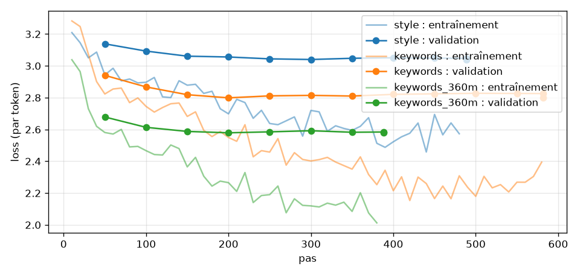
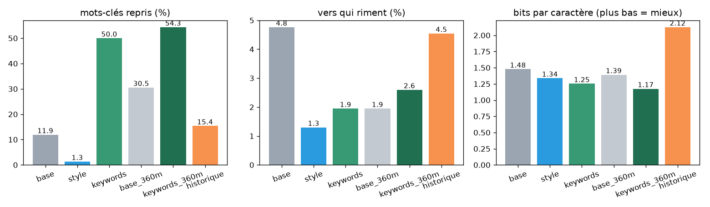

# Expériences LoRA : adapter un modèle pré-entraîné à nos comptines

Cette partie du projet est **indépendante du modèle historique** (notebooks 01 à 08), qui reste
intact. Au lieu d'entraîner un modèle de zéro, on part de **SmolLM2**, un petit modèle de langue
anglais déjà entraîné par Hugging Face, et on l'adapte à nos comptines avec **LoRA**
(*Low-Rank Adaptation*), en n'entraînant qu'environ 1 à 2 % de ses paramètres.

**Résultat principal** : avec SmolLM2-360M + LoRA, le modèle reprend **54 % des mots-clés**
(contre 31 % sans adaptation et 15 % pour notre modèle historique), écrit des comptines de 4 vers
dans **99 %** des cas, et prédit les comptines de test à **1,17 bit par caractère** (contre 2,12
pour notre modèle historique). Les rimes restent faibles (2,6 % des vers).

## Sommaire

1. [Ce que fait LoRA](#1-ce-que-fait-lora)
2. [Le modèle choisi](#2-le-modèle-choisi--smollm2)
3. [Les données](#3-les-données)
4. [Les deux expériences](#4-les-deux-expériences)
5. [L'entraînement](#5-lentraînement)
6. [Les résultats](#6-les-résultats)
7. [Limites](#7-limites)
8. [Refaire les expériences](#8-refaire-les-expériences)
9. [Fiches pour l'oral](#9-fiches-pour-loral)

## 1. Ce que fait LoRA

Un modèle de langue est fait de couches linéaires : chacune multiplie son entrée `x` par une
matrice de poids `W` (de taille d × k). Un **fine-tuning complet** modifie toutes ces matrices.

**LoRA gèle `W`** et ajoute à côté deux petites matrices entraînables, `A` (r × k) et `B` (d × r),
avec un **rang r** petit (ici 8). La couche calcule alors :

```
h = W·x  +  (alpha / r) · B·A·x
    └ figé ┘  └──── la correction apprise ────┘
```

- `B·A` est une matrice d × k, comme `W`, mais de **rang au plus r** : une correction « simple »
  de la couche d'origine, décrite avec r × (d + k) nombres au lieu de d × k.
- `B` est initialisée à **zéro** : au début de l'entraînement, `B·A = 0`, et le modèle adapté est
  exactement le modèle d'origine. L'entraînement apprend seulement l'écart.
- `alpha / r` (ici 16 / 8 = 2) règle l'amplitude de la correction.
- On peut **retirer l'adaptateur** (`A` et `B`, enregistrés à part, 13 à 21 Mo) et retrouver le
  modèle d'origine, ou en charger un autre sur le même modèle de base.

**Quelles couches ?** Dans chacun des 30 blocs Transformer de SmolLM2-135M, les 7 projections
linéaires : `q_proj`, `k_proj`, `v_proj`, `o_proj` (attention) et `gate_proj`, `up_proj`,
`down_proj` (feed-forward). `train_lora.py` vérifie automatiquement que ces noms existent dans le
modèle avant de configurer LoRA.

**Combien de paramètres entraînés ?**

| Modèle | Paramètres au total | Paramètres LoRA entraînés |
| --- | --- | --- |
| SmolLM2-135M | 134 515 008 | **2 442 240 (1,82 %)** |
| SmolLM2-360M | 361 821 120 | **4 341 760 (1,20 %)** |

**Pourquoi LoRA demande moins de mémoire.** Pour entraîner un paramètre avec AdamW, il faut
garder le poids, son gradient et deux moyennes (les « moments » d'Adam) : 16 octets par
paramètre en float32. Un fine-tuning complet du 135M demanderait donc environ
134,5 M × 16 o ≈ **2,2 Go** rien que pour ça. Avec LoRA, les 134,5 M poids figés n'ont ni gradient
ni moments : 4 octets chacun (0,54 Go), et seuls les 2,4 M paramètres LoRA coûtent 16 octets
(≈ 39 Mo). Le reste de la mémoire sert aux activations. Mesuré sur la RTX 3050 (4 Go) : pic de
2,5 Go pour le 135M (lots de 8), 3,95 Go pour le 360M en lots de 8 (trop juste : on a utilisé des
lots de 4 avec une accumulation de gradient de 4, pour le même lot effectif de 16).

## 2. Le modèle choisi : SmolLM2

[SmolLM2](https://huggingface.co/HuggingFaceTB/SmolLM2-135M) (Hugging Face, licence Apache 2.0) :
architecture Llama, entraîné sur de l'anglais. Choisi parce qu'il est **petit** (il tient
largement sur une carte de 4 Go, et peut même s'entraîner sur CPU), **récent** et **compatible
avec PEFT**. Le projet est en anglais : pas besoin d'un modèle multilingue.

| | SmolLM2-135M | SmolLM2-360M |
| --- | --- | --- |
| Blocs, dimension | 30 blocs, 576 | 32 blocs, 960 |
| Vocabulaire | 49 152 tokens (BPE) | idem |
| Utilisé pour | les deux expériences | l'expérience 2, pour voir l'effet de la taille |

On part de la version **base** (pas « Instruct ») : les deux expériences ont le même point de
départ, et on mesure ce que LoRA apprend vraiment.

## 3. Les données

`prepare_data.py` reprend les 2 981 comptines du projet (notebook 01) et :

1. **nettoie** légèrement (espaces, vers vides) en gardant les vers, un par ligne ;
2. **supprime les doublons exacts** ;
3. **regroupe les variantes** : deux comptines qui partagent leur premier ou leur dernier vers sont
   la même comptine (une autre version, ou une autre strophe de la même chanson). On obtient
   **1 843 groupes** ;
4. **sépare par groupe** : toutes les versions d'une comptine sont du même côté. Sans ça, 117
   comptines de l'ancienne validation avaient une « cousine » à l'entraînement (fuite) ;
5. tire les **mots-clés dans la comptine elle-même** (mots porteurs de sens, pondérés par leur
   rareté, IDF calculé sur l'entraînement seulement) : la consigne est toujours vraie ;
6. formate et **tokenise** avec le tokenizer de SmolLM2, en masquant la consigne (`-100`) : la loss
   ne porte que sur la comptine, terminée par `<|endoftext|>` pour apprendre à s'arrêter.

| Split | Comptines | Exp. 1 (style) | Exp. 2 (mots-clés) |
| --- | --- | --- | --- |
| Entraînement | 2 599 | 2 599 exemples | 3 094 (2 jeux de mots-clés par comptine) |
| Validation | 249 | 249 | 140 |
| **Test** | 133 | 133 | **77** |

Le **test** ne contient que des comptines de l'ancienne validation dont **aucune version** n'a été
vue par le modèle historique : la comparaison est équitable pour tous les modèles.

`check_data.py` vérifie qu'aucun groupe n'est à cheval sur deux splits, que chaque mot-clé est
dans sa comptine et que le masquage est correct, et affiche des exemples.

## 4. Les deux expériences

**Expérience 1 — style.** Le modèle voit seulement des comptines, après un court en-tête. Il
apprend à *écrire comme* le corpus.

```
Nursery rhyme:
Handy Spandy, Jack-a-dandy, ...<|endoftext|>
```

**Expérience 2 — mots-clés.** Le modèle voit une consigne avec des mots-clés, puis la comptine.
Il apprend à *utiliser les mots demandés*.

```
Keywords: loves, brought
Instruction: Write a short nursery rhyme in English using these words.
Rhyme:
Handy Spandy, Jack-a-dandy,
Loves plum-cake and sugarcandy; ...<|endoftext|>
```

Aucun schéma de rimes n'est imposé dans la consigne : seulement 10 % des comptines de 4 vers du
corpus sont en AABB, et écrire « AABB » partout aurait été faux. Les rimes sont mesurées à
l'évaluation, quel que soit leur schéma.

Les deux expériences partagent tous les réglages (`config.yaml`) : r = 8, alpha = 16, dropout
0,05, learning rate 2e-4 avec échauffement (5 %) puis décroissance en cosinus, AdamW, lot effectif
de 16, 3 epochs, mesure de la validation tous les 50 pas, et **on garde l'adaptateur du meilleur
pas de validation**.

## 5. L'entraînement

Sur une RTX 3050 Laptop (4 Go) :

| Run | Modèle | Durée | Pas | Meilleur pas | Val. loss (perplexité) | Test loss (perplexité) |
| --- | --- | --- | --- | --- | --- | --- |
| style | 135M | 12 min | 489 | 300 | 3,040 (20,9) | 3,063 (21,4) |
| keywords | 135M | 13 min | 582 | 200 | 2,799 (16,4) | 2,950 (19,1) |
| keywords_360m | 360M | 19 min | 388 (2 epochs) | 200 | **2,579 (13,2)** | **2,769 (15,9)** |



**Lecture des courbes.** La loss d'entraînement baisse jusqu'au bout, mais celle de validation
atteint son minimum tôt (après environ 1 epoch pour l'expérience 2), puis stagne ou remonte
légèrement : le modèle commence à apprendre ses ~2 600 comptines par cœur. Entraîner plus longtemps
n'aurait rien apporté ; le levier utile était la **taille du modèle** (360M). Sur CPU seul, ces
entraînements prendraient environ 1 h 40 et 2 h 15 (mesuré sur quelques pas).

La **perplexité** (exp de la loss) se lit comme le nombre de tokens entre lesquels le modèle hésite
en moyenne, sur 49 152. Elle ne se compare qu'entre modèles SmolLM2, qui partagent le tokenizer.

## 6. Les résultats

`evaluate.py`, sur les 77 comptines de test, avec les mêmes consignes, la même graine et les mêmes
réglages de tirage (température 0,8, top-k 40, une seule comptine par consigne) :

| Modèle | Mots-clés repris | Tous les mots | Vers qui riment | 4 vers | Mots par vers | Bits / car. | Perplexité |
| --- | --- | --- | --- | --- | --- | --- | --- |
| SmolLM2-135M sans adaptation | 11,9 % | 5,2 % | 4,8 % | 70 % | 4,8 | 1,48 | 32,1 |
| 135M + LoRA, exp. 1 (style)* | 1,3 % | 1,3 % | 1,3 % | 81 % | 6,3 | 1,34 | 23,2 |
| 135M + LoRA, exp. 2 (mots-clés) | 50,0 % | 22,1 % | 1,9 % | 96 % | 6,4 | 1,25 | 19,0 |
| SmolLM2-360M sans adaptation | 30,5 % | 16,9 % | 1,9 % | 52 % | 4,7 | 1,39 | 26,3 |
| **360M + LoRA, exp. 2** | **54,3 %** | **28,6 %** | 2,6 % | **99 %** | 6,4 | **1,17** | **15,8** |
| Notre modèle historique (seul) | 15,4 % | 3,9 % | 4,5 % | 56 % | 6,4 | 2,12 | — |
| *Vraies comptines du test* | — | — | *39,6 %* | *100 %* | *6,8* | — | — |

\* Le modèle « style » ne reçoit pas les mots-clés : son taux correspond au hasard.



**Comment lire ce tableau :**

- **LoRA apprend à utiliser la consigne** : de 12 % à 50 % de mots-clés repris sur le 135M, de 30 %
  à 54 % sur le 360M, avec 1,2 à 1,8 % des paramètres entraînés.
- **LoRA apprend la forme** : de 52-70 % à 96-99 % de textes de 4 vers, avec des vers de la longueur
  des vraies comptines (6,4 mots contre 6,8).
- **Les bits par caractère** mesurent à quel point le modèle prédit de vraies comptines jamais vues ;
  ils ne dépendent pas du tokenizer, d'où la comparaison possible avec notre modèle historique.
  Le pré-entraînement de SmolLM2 fait la différence : 1,17 contre 2,12. Les textes sont nettement
  plus grammaticaux et cohérents (voir `results/examples.md`).
- **Pas de récitation** : 1 à 2 % de vers recopiés du corpus d'entraînement.
- **Les rimes ne sont pas apprises** : 2 à 5 % pour tous les modèles, contre 40 % dans les vraies
  comptines (voir les limites).

Fichiers : `results/metrics.json` (tous les chiffres), `results/examples.md` (les comptines de
chaque modèle pour 6 consignes), `results/generations.json` (les 77 comptines de test de chaque
modèle, à côté de la vraie).

## 7. Limites

- **Petit jeu de test** : 77 comptines, soit une marge d'environ ±8 points sur les taux de
  mots-clés. L'écart entre 135M et 360M (50 % contre 54 %) n'est pas significatif ; l'effet de
  LoRA (12 % → 50 %) l'est largement.
- **Les rimes** : la mesure se fonde sur l'orthographe de la fin des mots. Le modèle, lui, voit des
  tokens BPE qui cachent l'orthographe et la prononciation des fins de mots, et 2 600 comptines ne
  suffisent pas pour qu'il apprenne à rimer.
- **Le sens** n'a pas de mesure automatique : on le juge en lisant les exemples ; les bits par
  caractère mesurent la qualité de l'anglais, pas la logique de l'histoire.
- **Comparaison avec le modèle historique** : il est évalué seul, sans son « coup de pouce » ni son
  meilleur de 8, pour comparer les modèles et non les stratégies de génération.

## 8. Refaire les expériences

Le groupe de dépendances `lora` (transformers, peft, datasets, accelerate, pyyaml) est installé par
défaut avec `uv sync`.

```bash
uv run python lora_experiments/prepare_data.py           # corpus → lora_experiments/data/
uv run python lora_experiments/check_data.py             # vérifications + exemples
uv run python lora_experiments/train_lora.py --experiment keywords --smoke   # test de 10 pas
uv run python lora_experiments/train_lora.py --experiment style
uv run python lora_experiments/train_lora.py --experiment keywords
uv run python lora_experiments/train_lora.py --experiment keywords --model HuggingFaceTB/SmolLM2-360M --epochs 2 --batch-size 4 --grad-accum 4 --tag _360m
uv run python lora_experiments/evaluate.py               # → lora_experiments/results/
uv run python lora_experiments/generate_lora.py --model keywords_360m cat moon
```

Le site (`uv run python serveur.py`, puis http://localhost:8000) propose « Our GPT » (le projet
initial), « SmolLM2 + LoRA » (l'adaptateur `keywords_360m`) ou les deux côte à côte.

**Sans carte graphique NVIDIA** : tout fonctionne sur CPU, en plus lent (environ 1 h 40 à 2 h 15
par entraînement). Le notebook `notebooks/lora_colab.ipynb` déroule les mêmes étapes sur
**Google Colab** (GPU T4 gratuit quand il est disponible) : il clone le dépôt, installe
`requirements.txt` et lance les scripts.

| Fichier | Rôle |
| --- | --- |
| `config.yaml` | Tous les réglages (modèle, données, LoRA, entraînement, formats) |
| `prepare_data.py` | Le corpus : nettoyage, groupes, splits, mots-clés, tokenisation |
| `check_data.py` | Les vérifications du corpus et des exemples |
| `train_lora.py` | L'entraînement LoRA d'une expérience |
| `generate_lora.py` | La génération en ligne de commande (et les fonctions du site) |
| `evaluate.py` | La comparaison de tous les modèles sur le jeu de test |
| `outputs/<run>/` | Les adaptateurs, leurs mesures et leur courbe de loss |
| `results/` | Les résultats de l'évaluation |
| `notebooks/lora_colab.ipynb` | Le déroulé complet, pour Colab ou en local |

## 9. Fiches pour l'oral

**Quels paramètres sont entraînés ?** Seulement les matrices `A` et `B` ajoutées aux 7 projections
de chaque bloc : 2,4 M sur 134,5 M (1,82 %) pour le 135M. Les poids de SmolLM2, les embeddings et
la couche de sortie sont gelés.

**Pourquoi moins de mémoire ?** Pas de gradient ni de moments d'Adam pour les poids gelés :
16 octets par paramètre entraîné, mais 4 seulement par paramètre gelé.

**Comment l'adaptateur modifie la sortie ?** Chaque couche ciblée ajoute `(alpha/r)·B·A·x` à sa
sortie habituelle `W·x`. Ces petites corrections, couche après couche, changent la distribution
du token suivant : le modèle préfère les tokens des mots-clés et la forme des comptines.

**Pourquoi garder le meilleur pas de validation ?** La loss d'entraînement baisse toujours ; celle
de validation remonte quand le modèle apprend par cœur. Le meilleur pas de validation est le
moment où il généralise le mieux (*early stopping*).

**Pourquoi des bits par caractère ?** Une loss par token dépend du tokenizer (49 152 tokens pour
SmolLM2, 14 122 pour notre modèle) ; ramenée au caractère, elle compare des modèles différents
sur le même texte.

**Pourquoi séparer par groupes ?** Pour qu'aucune version d'une comptine de test n'ait été vue à
l'entraînement : sinon on mesurerait de la mémoire, pas de la génération.
